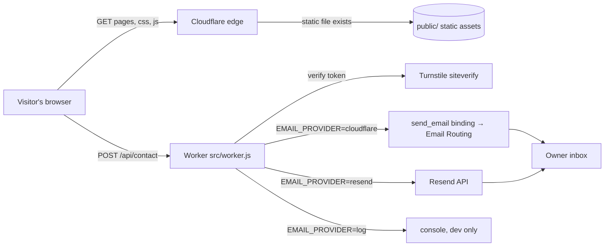

# Architecture

## Overview



- Static files are served directly from the edge and never run the Worker.
- `run_worker_first: ["/api/*"]` makes sure API routes always reach the Worker.
- Paths that don't match anything serve `public/404.html` (`not_found_handling: "404-page"`).

## Target file layout

```
aminy-v2-phone/
├── CLAUDE.md                 # instructions for Claude Code
├── package.json              # wrangler (dev dependency) + scripts
├── wrangler.jsonc            # Worker + assets config
├── .dev.vars.example         # template for local secrets (copy to .dev.vars)
├── .gitignore                # node_modules, .wrangler, .dev.vars
├── src/
│   ├── worker.js             # router: /api/contact → handler, else assets
│   ├── contact.js            # parse, validate, honeypot, Turnstile, send
│   ├── validate.js           # pure validation functions (unit-tested)
│   └── email.js              # providers: log | resend | cloudflare
├── test/
│   └── validate.test.js      # node:test unit tests
├── scripts/
│   ├── smoke-contact.mjs     # POSTs sample payloads to a running server
│   └── make-images.mjs       # renders og-image.png + icons from SVG
├── public/                   # ← everything here is publicly served
│   ├── index.html
│   ├── 404.html  privacy.html  terms.html  warranty.html
│   ├── robots.txt  sitemap.xml  _headers  site.webmanifest
│   ├── assets/               # og-image.png, apple-touch-icon.png, icons
│   ├── css/                  # existing stylesheets (+ legal.css)
│   └── js/
│       ├── animations.js  navbar.js  contact.js  quote.js
│       └── data/prices.js    # all pricing data (D-05)
└── docs/
```

> ⚠️ Anything under `public/` is downloadable by anyone. Never put secrets, notes or source files there.

## Configuration

`wrangler.jsonc` (outline; Phase 0 creates the real file):

```jsonc
{
  "name": "aminy-phone-repair",
  "main": "src/worker.js",
  "compatibility_date": "<date of Phase 0>",
  "assets": {
    "directory": "./public",
    "binding": "ASSETS",
    "not_found_handling": "404-page",
    "run_worker_first": ["/api/*"]
  },
  "observability": { "enabled": true },
  "vars": {
    "EMAIL_PROVIDER": "resend",          // log | resend | cloudflare
    "MAIL_FROM": "onboarding@resend.dev",// later: quotes@aminyrepair.com.au
    "MAIL_TO": "<owner inbox>",          // owner fills in (manual 03)
    "ALLOWED_ORIGINS": "https://aminyrepair.com.au,https://www.aminyrepair.com.au"
  }
  // Added in Phase 2b once Email Routing is live:
  // "send_email": [{ "name": "SEND_EMAIL", "destination_address": "<owner inbox>" }]
}
```

Secrets are set with `npx wrangler secret put <NAME>` and never committed:

| Secret | Used by | Local value (`.dev.vars`) |
|---|---|---|
| `TURNSTILE_SECRET_KEY` | contact.js | `1x0000000000000000000000000000000AA` (test key: always passes) |
| `RESEND_API_KEY` | email.js (`resend`) | Not needed locally when `EMAIL_PROVIDER=log` |

The public Turnstile **site key** goes in `index.html`. Locally, use the test site key `1x00000000000000000000AA`.

## API contract: `POST /api/contact`

Request: `Content-Type: application/json`

```json
{
  "firstName": "Jane", "lastName": "Citizen",
  "email": "jane@example.com", "phone": "0412 345 678",
  "device": "iPhone 15 Pro — Screen Replacement",
  "message": "Cracked top-left corner",
  "quote": { "model": "iPhone 15 Pro", "issue": "Screen Replacement", "total": 385 },
  "website": "",
  "turnstileToken": "<token>"
}
```

| Rule | Detail |
|---|---|
| Required | firstName, lastName, email, device (after trimming) |
| Max lengths | names 60, email 254, phone 20, device 200, message 2000 |
| Phone | optional; once spaces, dashes and brackets are removed it must match `^(\+61\|0)\d{9}$` |
| `quote` | optional; if present it must be `{model:string, issue:string, total:number}` |
| Honeypot | if `website` is non-empty, return `200 {ok:true}` but **don't send anything** (silently drop the bot) |
| Origin | reject with 403 if the `Origin` header isn't in `ALLOWED_ORIGINS` (localhost is allowed in dev) |
| Body size | reject with 413 if larger than 10 KB |

Responses: `200 {ok:true}` · `400 {ok:false, error, fields:[...]}` · `403 {ok:false, error:"verification_failed"}` · `405` for anything other than POST · `413` · `502 {ok:false, error:"delivery_failed"}`

The email sent to the owner has the subject `New repair enquiry — <device>`, `reply-to` set to the customer's email, and a plain-text body listing every field, the quote, and the time in Australia/Melbourne.

## Front-end ↔ quote hand-off

1. "Book This Repair" stores the chosen model, issue and total on the contact form (in a hidden field or a JS module variable).
2. It pre-fills `#device` with `"<model> — <issue>"` and shows a small "Quote attached: $X incl. GST" note, which can be removed.
3. It scrolls to the form and moves focus to `#firstName`.
